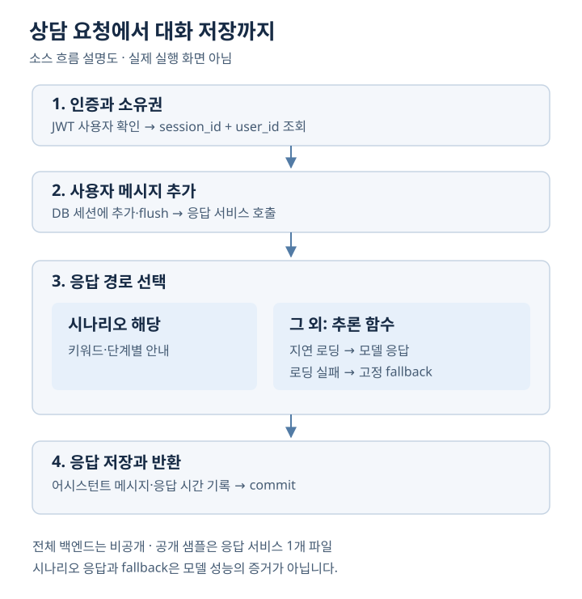

[← 포트폴리오](../README.md)

# 상담 sLLM 캡스톤

**상담 데이터 준비부터 인증·세션·대화 저장까지 연결한 AI 상담 보조 프로토타입**

| 구분 | 내용 |
| --- | --- |
| 팀과 역할 | 3인 팀 팀장 · 백엔드 구현·통합, 일정·역할 조율 |
| 담당 범위 | FastAPI, JWT, 사용자·세션 소유권 검사, 메시지·DB 흐름 / 전처리·LLM 연동 참여 |
| 기술 | Python, FastAPI, SQLAlchemy, JWT, Transformers, PEFT/LoRA |
| 공개 코드 | [capdesign](https://github.com/kangyunseong/capdesign) — 응답 서비스 파일 1개 |

## 문제

언어 모델을 호출하는 것만으로 대화 서비스가 완성되지는 않습니다. 상담 축어록을 일관된 입력 형식으로 바꾸고, 로그인한 사용자의 세션을 확인하며, 생성한 응답을 대화 기록에 연결해야 했습니다. 저는 백엔드를 중심으로 이 흐름을 구현·통합했습니다.

## 설계와 구현

*실제 소스의 처리 흐름을 요약한 설명도입니다. 비공개 코드와 상담 원문은 포함하지 않았습니다.*

### 1. 인증과 세션 소유권을 분리

JWT로 현재 사용자를 식별한 뒤, 세션 조회 조건에 `session_id`와 `user_id`를 함께 사용했습니다. 토큰의 유효성과 특정 대화에 접근할 권한을 별도로 확인하도록 구성했습니다. 사용자 메시지를 DB 세션에 추가한 후 응답을 생성하고, 어시스턴트 메시지와 응답 시간을 기록하는 흐름을 연결했습니다.

### 2. 응답 서비스와 모델 실행의 책임 분리

세션별 키워드 시나리오를 먼저 확인하고, 해당하지 않을 때 추론 함수를 호출합니다. 모델 모듈은 필요 시 로딩하며, 로딩에 실패하면 고정 응답 함수를 사용합니다. 시나리오·모델·fallback은 서로 다른 응답 경로이므로, 화면에 답변이 표시되는 것과 모델 추론이 성공하는 것을 구분했습니다. 공개 근거: [backend/app/services/chat_service.py](https://github.com/kangyunseong/capdesign/blob/eb13c0e653237312c19b2666ca014b267d38919b/backend/app/services/chat_service.py#L122-L170), [backend/app/services/chat_service.py](https://github.com/kangyunseong/capdesign/blob/eb13c0e653237312c19b2666ca014b267d38919b/backend/app/services/chat_service.py#L80-L107).

### 3. 데이터 형식과 학습·추론 연결

축어록의 `dialog/utterances`, `text/content` 등 형식 차이를 처리하고 화자 표기를 정규화했습니다. 연속 내담자 발화를 모아 다음 상담자 발화와 연결하는 학습 쌍 구성에 참여했습니다. Qwen2.5-3B-Instruct와 PEFT/LoRA를 사용하는 학습·추론 코드가 있으며, LoRA 설정은 `r=16`, `alpha=32`입니다. 이 값은 코드 설정이며 학습 완료나 모델 품질을 나타내는 수치가 아닙니다.

## 디버깅과 검증

**확인 단위를 계정·권한·응답·저장으로 나눴습니다.** 최종 포트폴리오 6쪽의 기존 로컬 확인 기록에는 합성 계정 가입·로그인, 세션 소유권 확인, 사용자 메시지 4회 전송과 사용자·응답 8건 DB 저장이 기재되어 있습니다. 해당 기록은 서비스 연결 확인의 근거로 사용하며, 이번 포트폴리오 정리에서 동일 실행을 재현한 것은 아닙니다.

코드 대조에서는 다음을 구분했습니다.

- 세션 소유권 조건이 실제 조회에 포함되는지
- 시나리오 응답 이후 모델 로딩 분기가 어떻게 이어지는지
- 로딩 실패 시 fallback이 저장·재사용되는지
- DB에 기록된 모델 이름이 실제 실행 경로를 증명하는지 — 현재 고정 문자열만으로는 구분할 수 없음

## 결과와 남은 과제

백엔드에서 **인증 → 세션 확인 → 응답 분기 → 대화 저장**을 연결했습니다. 모델을 서비스에 붙일 때 데이터 형식과 접근 권한, 예외 처리를 함께 설계해야 한다는 점을 경험했습니다.

현재 공개 저장소는 설정 모듈·라우터·학습·추론 스크립트를 포함하지 않아 단독 실행 가능한 전체 서비스가 아닙니다. 학습 완료 로그·체크포인트·모델 성능·실사용 효과는 확인되지 않았습니다. 또한 전체 대화 이력의 추론 입력, 다중 워커의 시나리오 상태 공유, fallback 이후 재시도, 학습·추론 프롬프트 정합성은 후속 검증 과제입니다.

## 구현 근거

공개 파일: [backend/app/services/chat_service.py](https://github.com/kangyunseong/capdesign/blob/eb13c0e653237312c19b2666ca014b267d38919b/backend/app/services/chat_service.py#L80-L170). 아래는 비공개 보관본에서 확인한 경로이며, 원문은 이 저장소에 포함하지 않았습니다.

| 구현 | 비공개 보관본의 파일 경로 |
| --- | --- |
| 사용자 인증·소유권 | `capstone/backend/app/api/dependencies.py`, `capstone/backend/app/api/routes/sessions.py` |
| 메시지 저장·응답 호출 | `capstone/backend/app/api/routes/chat.py` |
| 학습 데이터 준비 | `capstone/scripts/data_prep/prepare_dataset.py` |
| LoRA 학습·추론 | `capstone/scripts/training/train_sft.py`, `capstone/scripts/inference/chat_inference.py` |

개인 담당 범위는 본인 제공 역할 설명과 최종 포트폴리오를 기준으로 하며, 구현의 존재는 대응 소스와 대조했습니다. 팀 전체 결과와 외부 기반 모델의 개발을 개인 단독 성과로 귀속하지 않습니다.
