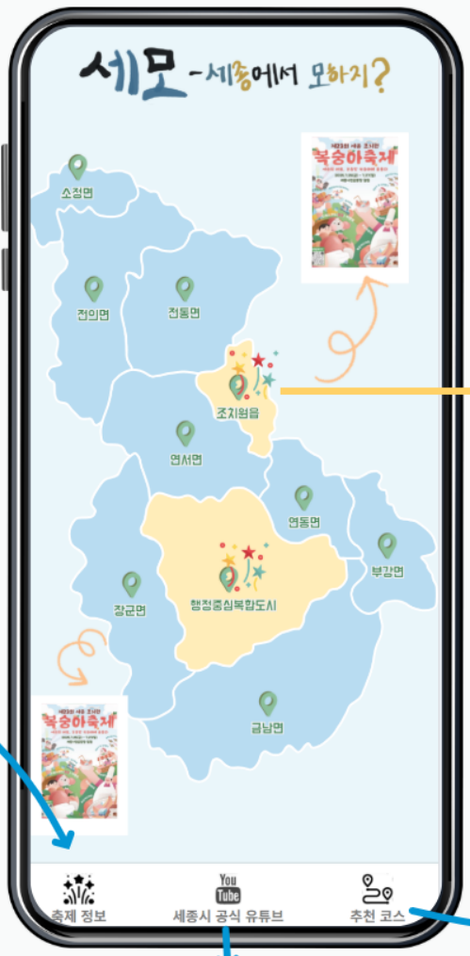
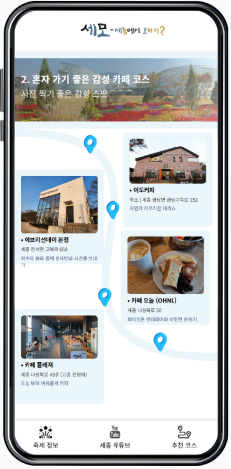

[← 포트폴리오](../README.md)

# 세모 — 세종에서 뭐하지?

**축제·여행 코스·주변 장소를 한 흐름으로 탐색하는 팀 서비스**

- **프로젝트**: 2025 충청톤 / 세종 DX 해커톤 · 5인 팀
- **나의 역할**: 백엔드 개발 — 수집·FastAPI·SQLAlchemy·DB 연동, 통합 오류 수정
- **기술**: Python 3.11, FastAPI, SQLAlchemy, Requests, Selenium, BeautifulSoup, Kakao Local
- **소스**: [finislesennuis/kuku](https://github.com/finislesennuis/kuku) — 최종 팀 저장소

## 문제와 팀 서비스

축제 정보가 여러 홈페이지에 흩어져 있어 일정과 장소를 다시 찾고, 축제 전후에 방문할 주변 장소도 별도로 검색해야 했습니다. 팀은 축제 정보와 여행 코스·장소를 함께 탐색하는 서비스를 구성했고, 저는 정보를 수집해 API와 DB로 연결하는 백엔드를 담당했습니다.

  
  
  

*팀 서비스 화면. 출처: 「세종DX해커톤 발표자료 - 최종본」 5·6쪽에서 화면 영역만 추출했습니다. 당시 발표 화면이며, 프론트엔드는 팀 공동 결과물입니다. 제 담당 범위는 수집·API·DB와 통합 디버깅입니다.*

## 설계와 구현

**API 요청 → 수집 서버 → 사이트별 파서 → 모델 저장 → 조회 API** 흐름으로 구성했습니다. API 서버는 로컬 크롤러에 HTTP 요청을 보내고, 크롤러는 축제·코스·주변 장소 유형에 따라 수집 함수를 선택합니다. 데이터 소스는 공식 웹사이트 HTML과 Kakao Local API입니다. 정부 공공데이터 OpenAPI 연동은 현재 소스에서 확인되지 않아 구현 항목에 넣지 않았습니다.

FastAPI의 입력·응답 스키마와 SQLAlchemy 모델을 연결하고, 축제·장소·코스 검색 및 코스별 장소 조회 경로를 다뤘습니다. 수집 서버 분리는 실행 책임을 나눈 구조이며, 현재 전체 수집은 순차 호출입니다. 병렬 수집·분산 작업 큐를 구축한 것으로 설명하지 않습니다. 근거: [backend/crawler_api.py](https://github.com/finislesennuis/kuku/blob/e3d8e7a1eeab4784a9897afd0be729b83e703201/backend/crawler_api.py#L37-L52), [backend/local_crawler.py](https://github.com/finislesennuis/kuku/blob/e3d8e7a1eeab4784a9897afd0be729b83e703201/backend/local_crawler.py#L31-L122), [backend/search.py](https://github.com/finislesennuis/kuku/blob/e3d8e7a1eeab4784a9897afd0be729b83e703201/backend/search.py#L10-L73).

## 디버깅 1 · 필드명은 API와 DB 사이의 계약

**문제:** 축제 설명 필드가 일부 코드에서 `descript`, 다른 경로에서 `description`으로 사용됐습니다. 저장·조회 흐름에서 같은 데이터가 다른 이름으로 취급되는 문제가 있었습니다.

**수정:** ORM 모델과 Pydantic 스키마의 필드명을 `description`으로 맞췄습니다. 단일 요청 함수만 고치지 않고, 모델·스키마·저장 경로를 함께 확인했습니다.

**확인된 결과:** [수정 커밋 f9cae06](https://github.com/finislesennuis/kuku/commit/f9cae06e3d4a3ed9eda2378b2c5a3ed5b3d86e32)에서 모델·스키마 변경을 확인할 수 있습니다. 최종 코드의 필드 정의는 [backend/models.py](https://github.com/finislesennuis/kuku/blob/e3d8e7a1eeab4784a9897afd0be729b83e703201/backend/models.py#L6-L78), [backend/schemas.py](https://github.com/finislesennuis/kuku/blob/e3d8e7a1eeab4784a9897afd0be729b83e703201/backend/schemas.py#L17-L82)에 있습니다. 운영 DB 마이그레이션이나 전체 회귀 테스트가 완료되었다는 의미는 아닙니다.

## 디버깅 2 · 장소 정보와 코스 연결의 저장 책임 분리

**문제:** 코스 크롤링 과정에서 기존 `Place` 정보를 갱신하면서 코스–장소 관계도 반복 추가하는 구조였습니다.

**수정:** 코스 수집 경로에서 `Place` 생성·갱신을 제거하고, `course_id + place_name`으로 기존 연결을 조회한 뒤 `CoursePlace`에 저장하도록 변경했습니다. 코스에 장소를 연결하는 작업이 기존 장소 정보를 덮어쓰지 않도록 저장 책임을 좁혔습니다.

**확인된 결과:** [수정 커밋 392ac70](https://github.com/finislesennuis/kuku/commit/392ac702996cb97938dc37618c268f0c47f755c0)과 최종 [backend/course_crawler.py](https://github.com/finislesennuis/kuku/blob/e3d8e7a1eeab4784a9897afd0be729b83e703201/backend/course_crawler.py#L73-L157)에서 변경을 대조할 수 있습니다. 이 중복 확인은 애플리케이션 조회 조건이므로 동시 요청까지 막는 DB 고유 제약과는 구분합니다.

## 결과와 남은 과제

팀 서비스에서 사용할 **수집 → 저장 → 조회** 경로를 연결했고, 필드명과 관계 저장에서 발생한 통합 문제를 수정했습니다. 위 두 사례는 본인 역할 설명뿐 아니라 `kangyunseong` 계정 명의의 실제 diff로 확인되는 변경입니다. 전체 팀 백엔드나 화면을 단독 개발했다는 의미는 아닙니다.

발표자료는 당시 팀 서비스의 화면·맥락을 보여 주며 현재 운영 상태를 증명하지 않습니다. 코드 검토에서는 주변 장소 결과의 `x/y` 누락, 저장 시 경도·위도 매핑, 코스 수집에서 계산한 좌표가 저장되지 않는 문제가 남아 있음을 확인했습니다. 좌표 계약 테스트와 재수집·부분 실패 시 저장 일관성이 다음 개선 과제입니다. 근거: [backend/s_place.py](https://github.com/finislesennuis/kuku/blob/e3d8e7a1eeab4784a9897afd0be729b83e703201/backend/s_place.py#L62-L131), [backend/s_place.py](https://github.com/finislesennuis/kuku/blob/e3d8e7a1eeab4784a9897afd0be729b83e703201/backend/s_place.py#L172-L215), [backend/course_crawler.py](https://github.com/finislesennuis/kuku/blob/e3d8e7a1eeab4784a9897afd0be729b83e703201/backend/course_crawler.py#L73-L157).

발표자료의 전국 확장·광고 모델 등은 향후 구상으로 구분했으며, 서비스 성과로 포함하지 않았습니다.
