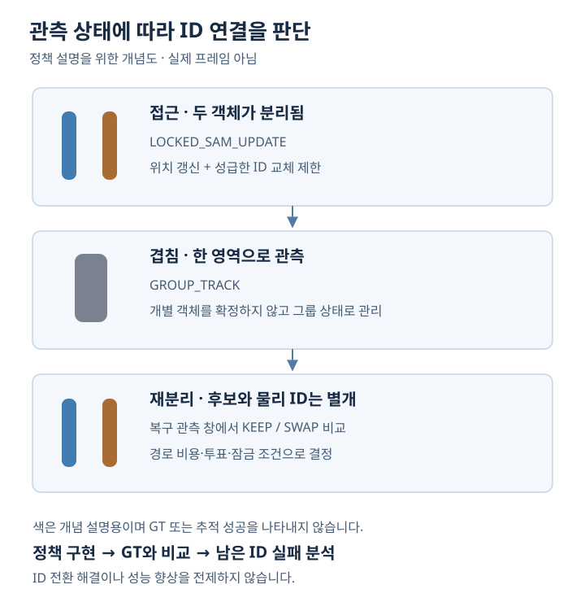

[← 포트폴리오](../README.md)

# MOT 객체 추적 연구

**객체를 다시 찾는 것과 같은 ID로 이어 가는 것을 구분한 두 펜 추적 연구**

| 구분 | 내용 |
| --- | --- |
| 문제 | 접근·가림·재분리 구간의 ID 전환 |
| 나의 역할 | 키프레임 추출·association 로직, SAM3 연동, 수동 GT 검수·실패 분석 |
| 기술 | Python, OpenCV, NumPy, 사전학습 SAM3 활용 |
| 소스 | [MOT-project](https://github.com/kangyunseong/MOT-project) — 키프레임·ID 연결 핵심 코드 |

## 문제

두 펜이 가까워지거나 겹치면 분할 결과가 하나의 영역으로 합쳐질 수 있습니다. 다시 두 객체로 분리되어도 검출 후보의 순서가 물리적인 펜의 정체성을 보장하지는 않습니다. 저는 프레임 선택, 관측 상태, ID 연결, GT 평가를 나누어 실패가 발생하는 지점을 분석했습니다.

*상태 정책을 설명하기 위해 새로 작성한 개념도입니다. 실제 프레임·검출 결과를 재현한 이미지가 아닙니다.*

## 설계와 구현

### 1. 이벤트 중심 키프레임 선택

MOG2 전경과 윤곽선에서 객체 후보를 추출하고, 중심·형상·움직임을 이용해 접근·겹침·분리·복구 상태를 구분했습니다. 상태 변화 주변의 프레임을 선택·보강하는 흐름을 구현했습니다. 공개 코드: [keyframe_extractor.py](https://github.com/kangyunseong/MOT-project/blob/06833c4a4a65d295521724e146c0f209f3a07c87/keyframe_extractor.py#L674-L800), [keyframe_extractor.py](https://github.com/kangyunseong/MOT-project/blob/06833c4a4a65d295521724e146c0f209f3a07c87/keyframe_extractor.py#L3443-L3634).

### 2. 분할과 ID 연결의 책임 분리

사전학습 SAM3의 분할 결과를 사용하고, 마스크·프레임 메타데이터를 ID 연결 단계에 전달했습니다. SAM3 자체를 새로 학습하거나 개발한 연구는 아닙니다. 공개 저장소는 외부에서 준비한 마스크와 메타데이터를 입력으로 받으며 전체 데이터·가중치·평가 산출물을 포함하지 않습니다. 입력 매핑 근거: [utils/associate_ids.py](https://github.com/kangyunseong/MOT-project/blob/06833c4a4a65d295521724e146c0f209f3a07c87/utils/associate_ids.py#L174-L261).

### 3. 불확실한 관측에서는 즉시 ID 교체를 제한

| 관측 상황 | 연결 정책 | 판단 의도 |
| --- | --- | --- |
| 근접하지만 분리 가능 | `LOCKED_SAM_UPDATE` | 위치를 갱신하면서 성급한 ID 교체 제한 |
| 한 영역으로 합쳐짐 | `GROUP_TRACK` | 개별 ID를 확정하기 어려운 구간을 그룹으로 처리 |
| 겹침 이후 재분리 | recovery window의 keep/swap 비교 | 여러 관측의 경로 비용·투표를 함께 고려 |
| 불확실한 복구 | hold/lock | 조건이 충분하지 않으면 기존 연결 유지 |

정책을 추가한 것과 성능이 좋아진 것은 별개로 판단했습니다. 상태 처리 후에도 ID 반전과 박스 이탈이 남았으며, 결과를 다시 GT와 비교했습니다. 구현 근거: [utils/associate_ids_stable.py](https://github.com/kangyunseong/MOT-project/blob/06833c4a4a65d295521724e146c0f209f3a07c87/utils/associate_ids_stable.py#L532-L663).

## GT 검수와 최신 평가

물리 ID, visibility, bbox의 검수 기준을 나누어 **선택 프레임 269장**을 수동 검수했습니다. 최신 GT에는 accepted bbox 442개와 corrected bbox 33개, 총 GT bbox 475개가 기록되어 있고 prediction bbox는 467개입니다.

**2026-09-11 · GT v15 재평가 · bbox 평가 269프레임 전체**

| 지표 | 결과 | 해석 범위 |
| --- | ---: | --- |
| DetA | **90.18%** | 검출 정확도 측면 |
| AssA | **42.03%** | ID 연결 정확도 측면 |
| HOTA | **61.57%** | 검출과 연결을 함께 보는 지표 |
| IDF1 | **67.52%** | 전역 ID 매칭 기준의 F1 |

물리 ID를 초기 고정 mapping으로 평가한 별도 정확도는 **31.40% (146/465)**, miss를 포함한 정확도는 **30.74% (146/475)** 입니다. 두 값은 분모가 다르며, IDF1과도 정의가 다릅니다. 선택 프레임 관측 기준 A/B의 ID switch는 각각 39회/35회로 기록되어 있습니다. 이는 모든 원본 프레임을 연속 평가한 횟수가 아닙니다.

### 이전 평가와 무엇이 달라졌나

이전 261프레임 평가에서 미승인 상태였던 8프레임의 bbox 검수 상태가 확정되면서, 최신 bbox 평가 범위가 **269프레임**으로 늘었습니다. **기존 `tracks.json`과 최신 GT로 다시 계산했으며 SAM3 추론·association을 재실행한 결과가 아닙니다.** 따라서 최신 수치와 이전 수치의 차이를 알고리즘 개선 효과로 해석하지 않습니다.

수치 출처는 2026-09-11 재평가 핵심 사실 기록과 최종 포트폴리오 8쪽입니다. 두 자료의 수치·평가 범위를 교차 확인했고 비율의 분모를 검산했습니다. 원본 GT·예측 파일이 이번 공개 자료에 포함되지 않아 HOTA·IDF1을 독립 재실행한 결과는 아닙니다. 공개 코드 커밋은 9월 6일의 핵심 구현이며, 9월 11일 평가 실행본과의 완전한 버전 대응은 별도 확인이 필요합니다.

## 결과와 남은 과제

**검출보다 물리 ID를 유지하는 association이 상대적 병목**임을 정량적으로 구분했습니다. 객체를 다시 검출하더라도 같은 ID를 유지하지 못하는 실패를 드러내고, 개선 대상을 연결 로직으로 좁혔다는 점이 이 연구의 결과입니다.

ID switching을 해결했거나 추론 속도를 개선했다고 주장하지 않습니다. 다음 과제는 외관 단서와 복구 조건을 개선한 뒤, 동일 GT·입력 조건에서 연결 지표와 전체 처리 시간을 비교하는 것입니다. 내부 `actual_swap` 카운터는 교체 분기 실행 횟수이며 GT 기반 IDSW로 사용하지 않습니다.

추적·진단 출력 코드: [utils/associate_ids_stable.py](https://github.com/kangyunseong/MOT-project/blob/06833c4a4a65d295521724e146c0f209f3a07c87/utils/associate_ids_stable.py#L733-L949). 실제 원본 영상·GT·내부 보고서·연구실 또는 회사 표시는 이 포트폴리오에 포함하지 않았습니다.
